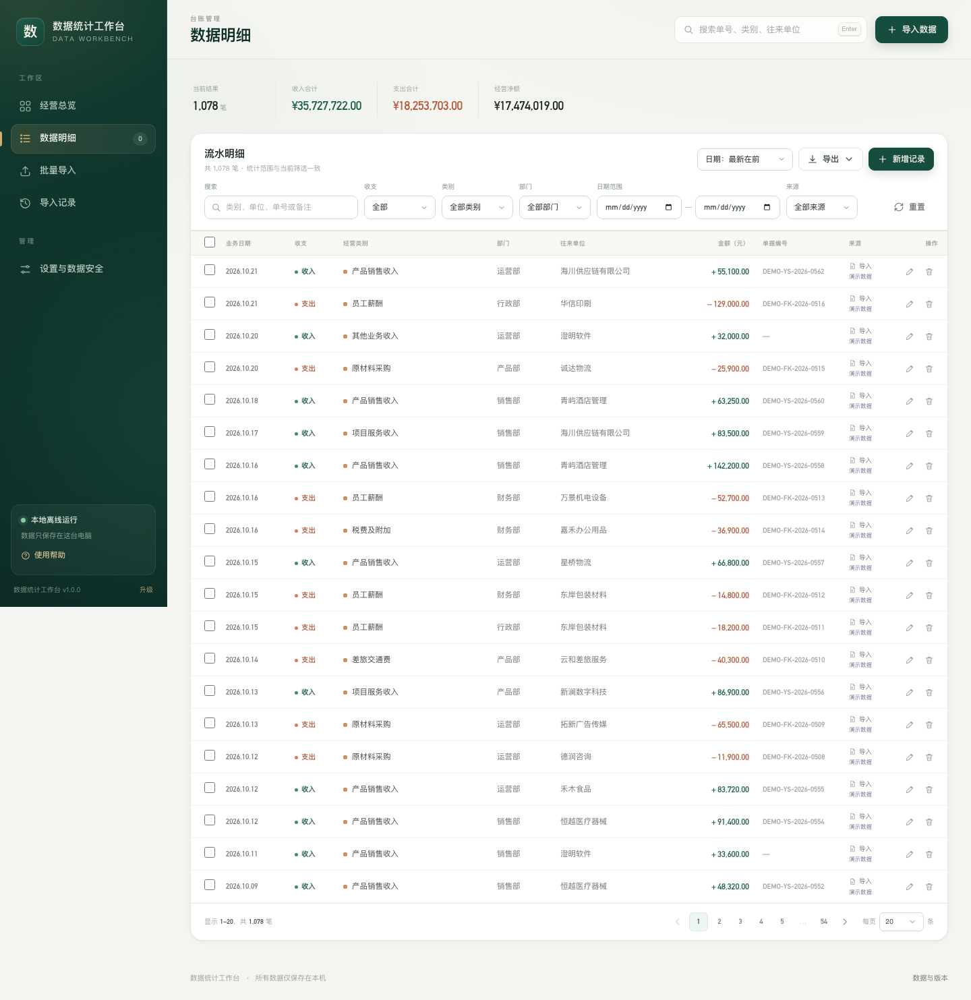
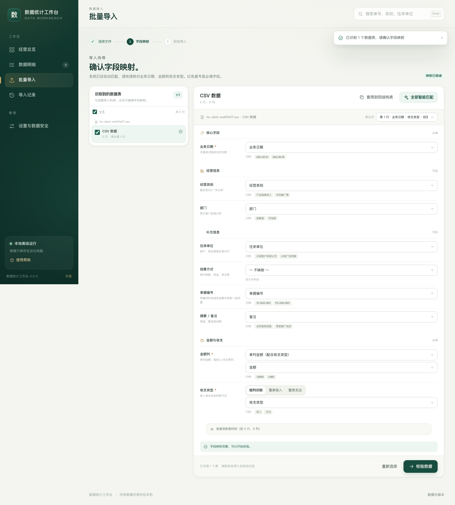
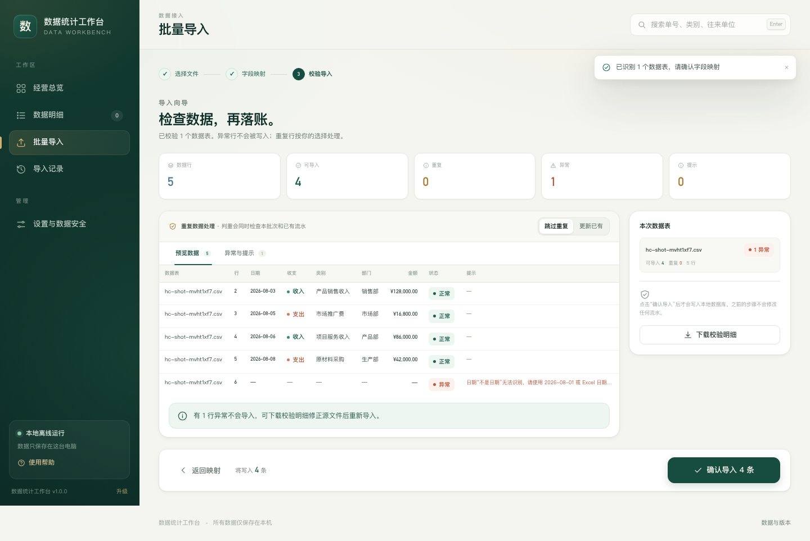
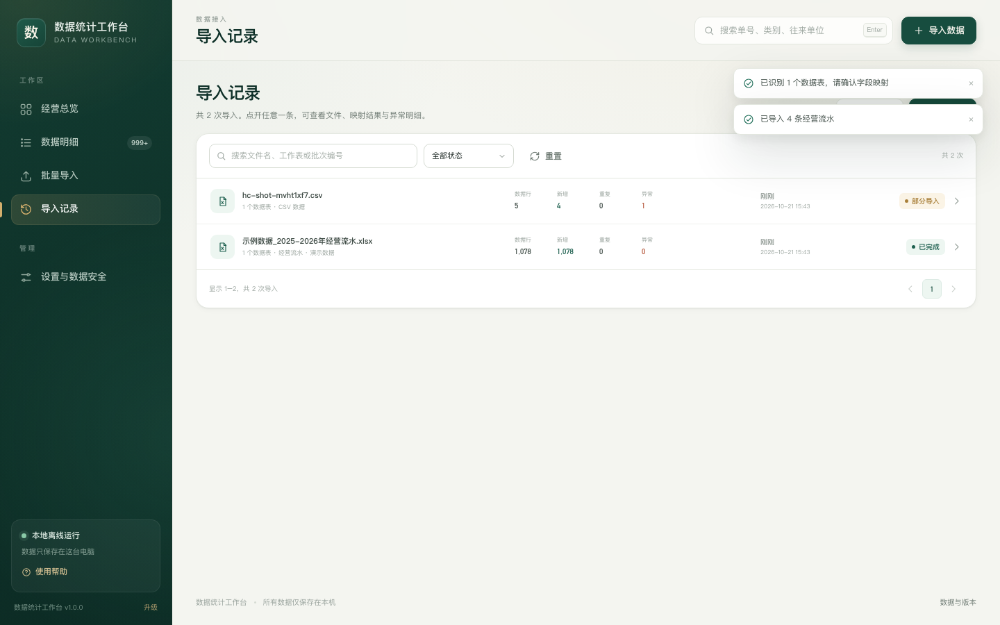

# 数据统计工作台

> 为办公室文员和财务文员准备的本地经营数据工作台：批量导入 Excel / Outlook 邮件，自动完成字段映射、校验、去重与汇总，并用清晰的仪表盘展示经营趋势。**全程离线，数据不出本机。**

> **下载：** [Windows 11 x64 离线包](https://github.com/lirunwen/data-stats-workbench/releases/download/v1.1.0/DataStatsWorkbench-Windows-x64-v1.1.0.zip)（内置 Python，解压即用，无需联网安装）。
> 安装、启动、迁移与卸载步骤见 **[用户指南](docs/用户指南.md)**；历史版本见 [Releases](https://github.com/lirunwen/data-stats-workbench/releases)。


## 1. 已实现能力

### 导入与数据治理
- 批量导入多个文件、多个工作表；可勾选需要的表。
- 支持 `.xlsx` / `.xlsm` / `.xls` / `.csv` / `.tsv` / `.txt`。
- 支持 Outlook `.msg` / `.oft` 与邮件 `.eml`；自动展开邮件附件中的 Excel / CSV。
- 同时支持邮件正文中的 HTML 表格，作为独立数据源。
- 表头自动识别，可手动切换「表头行」。
- 字段映射：日期、金额、收支类型、类别、部门、往来单位、结算方式、单据编号、备注。
- 中英文表头同义词自动匹配；金额支持**单列 + 收支列**，也支持**收入金额 / 支出金额双列自动拆分**。
- 逐行校验：日期、金额、收支类型、必填项、文本长度、未来日期、超大金额、缺类别等。
- 判重同时覆盖「本批次内」与「数据库已有记录」；可跳过重复或更新已有记录。
- 导入前预览、异常明细下载；异常行不写入，警告行可正常导入。
- 每个导入批次保留文件、映射、统计与完整异常报告，可追溯、可复查。

### 汇总与可视化
- 经营总览：收入、支出、净额、笔数，支持本月 / 本季 / 本年 / 全部 / 自定义期间。
- 与上期对比、经营净利率、近 12 个月收支趋势、收支构成、部门表现。
- 数据质量：分类完整度、未分类、未填部门、近期异常、重复识别。
- 分类 / 部门可点击直接下钻到筛选后的明细。

### 台账管理
- 经营流水增、删、改、查。
- 关键字搜索（类别、部门、往来单位、单据号、备注等）。
- 收支、类别、部门、日期、来源、导入批次筛选。
- 分页、每页条数、排序。
- 单条编辑 / 删除、批量删除。
- 导出筛选结果为 Excel（含汇总页）或 CSV。

### 本地运行与维护
- 无 CDN、无云服务、无外部字体、无外部接口；所有页面资源随程序分发。
- 只监听 `127.0.0.1`，同一局域网的其他电脑无法访问。
- SQLite 数据库 + 事务写入 + 启动完整性检查。
- 每日自动备份（保留 14 份）+ 手动备份；升级前自动备份。
- 单实例保护、端口自动回退、启动日志、磁盘清理。
- 离线升级：本机校验升级包哈希，版本目录独立，自动数据库备份，重启生效，可回退。
- 新版本启动失败时，可使用 `Recovery-DataStats.cmd` 紧急回退。


### 界面一览

| 数据明细 | 导入向导 |
| --- | --- |
|  |  |

| 导入校验 | 导入记录 |
| --- | --- |
|  |  |

| 设置与数据安全 | 批量导入起始页 |
| --- | --- |
|  |  |

## 2. Windows 11 直接使用

> 安装包与完整发布记录见 [Releases](https://github.com/lirunwen/data-stats-workbench/releases/latest)。
> 完整步骤（含系统要求、FAQ、卸载、从 v1.0.0 迁移）见 **[docs/用户指南.md](docs/用户指南.md)**。

### 方式 A：便携运行
1. 解压下载的 ZIP（不要只复制压缩包中的部分文件）。
2. 双击 `Start-DataStats.vbs`。
3. 首次启动会创建 `data\`，浏览器自动打开工作台。

### 方式 B：安装到本机
1. 解压后双击 `Install-DataStats.cmd`。
2. 程序复制到 `%LOCALAPPDATA%\DataStatsWorkbench`，并创建桌面 / 开始菜单快捷方式。
3. 不需要管理员权限，不需要安装 Python 或数据库。

运行包内置 Python 3.12.10 与全部依赖，**目标电脑完全不需要联网**。
更详细的使用说明见压缩包内的 `README.txt`，也可在应用左下角打开「使用帮助」。

端口默认 `8765`；若被占用会自动使用后续端口。程序只监听 `127.0.0.1`。
需要彻底停止后台服务时，在「设置与数据安全」底部点击「退出工作台」。

## 3. 导入流程

```text
选择文件 / 拖入邮件
       ↓
识别工作表、邮件附件与正文表格
       ↓
核对字段映射（可调整表头行）
       ↓
校验：异常 / 重复 / 警告预览
       ↓
事务写入 SQLite（异常行不写入）
       ↓
仪表盘、明细、导入记录即时更新
```

### 判重规则

| 场景 | 判重依据 |
| --- | --- |
| 有单据编号 | 年份 + 收支 + 单据编号 + 金额 + 类别 |
| 无单据编号 | 日期 + 收支 + 金额 + 类别 + 部门 + 往来单位 + 备注 |

- 判重优先在导入前完成，不会先写入再删除。
- 「更新已有」只会更新重复命中的记录，并保留原记录 ID。
- 完整规则可在应用「使用帮助」与「数据完整性说明」中查看。

### 支持字段

| 字段 | 必填 | 说明 |
| --- | --- | --- |
| 业务日期 | 是 | 支持 Excel 日期、`2026-08-03`、`2026/8/3`、`2026年8月3日`、仅到月份等 |
| 收支类型 | 是 | 收入 / 支出；可来自列，也可整表固定 |
| 金额 | 是 | 正数；支持货币符号与千分位；也支持收入/支出双列 |
| 经营类别 | 否 | 空值归入「未分类」并给出提示 |
| 部门 | 否 | 空值归入「未指定」 |
| 往来单位 / 结算方式 / 单据编号 / 摘要 | 否 | 用于检索、追溯与判重 |

## 4. 数据存储

```text
data/
├─ workbench.db              SQLite 主数据库（业务记录 / 批次 / 设置 / 审计）
├─ staging/               上传原文件与导入会话暂存（24 小时自动清理）
├─ reports/               批次异常明细 CSV
├─ backup/                每日自动备份 + 手动 / 升级前备份
├─ updates/               离线升级包暂存
└─ logs/                  运行日志
```

- 便携运行：数据在程序目录的 `data\`。
- 安装运行：数据在 `%LOCALAPPDATA%\DataStatsWorkbench\data`。
- 升级只替换程序目录，不动数据目录。
- 设置页可查看数据路径、立即备份、清理临时上传。

> 备份是 SQLite 数据库文件。需要恢复时，请先退出工作台，将备份文件复制为 `data\workbench.db`（同时移除旧的 `workbench.db-wal` / `workbench.db-shm`），再启动。建议操作前再备份当前文件。

## 5. 开发与构建

### 源码运行

```bash
python -m venv .venv
# Windows: .venv\Scripts\activate
source .venv/bin/activate
pip install -r requirements.txt
python app.py
```

打开 <http://127.0.0.1:8765>。开发模式默认使用项目下的 `data/`。

```bash
python app.py --data-dir /path/to/test-data   # 隔离测试数据
python app.py --no-browser                    # 不自动打开浏览器
```

### 测试

```bash
pip install -r requirements-dev.txt
python tests/smoke.py            # 后端与文件链路端到端测试
python tests/updater_selftest.py # 离线升级、哈希校验、备份与回退自测
```

冒烟测试覆盖：Excel / XLS / GBK CSV / MSG / EML、字段映射、异常行、批内去重、数据库去重、更新策略、CRUD、筛选分页、导出、模板、备份、演示数据、安全边界等。

### 构建 Windows 离线包

构建机需要联网准备一次运行时；目标机完全离线。

```bash
# 1. 准备 Windows x64 的 Python embeddable 与 wheelhouse
python packaging/build_portable.py \
  --embed-zip /path/python-3.12.10-embed-amd64.zip \
  --wheels /path/wheels2 \
  --out dist

# 2. 修改 version.json 后，生成可被应用内安装的升级包
python packaging/make_update.py \
  --notes "本次更新说明" \
  --min-from 1.0.0 \
  --out dist/updates
```

构建脚本会生成：

```text
dist/DataStatsWorkbench-Windows-x64-v<版本>.zip   # 可直接解压使用 / 安装
dist/updates/DataStats-Update-v<版本>.zip         # 设置页 → 离线升级
```

完整构建与升级包格式见 [packaging/README.md](packaging/README.md)。

## 6. 目录结构

```text
app.py                        本地启动器（端口、单实例、waitress、打开浏览器）
backend/
├─ api.py                     HTTP 路由与安全边界
├─ config.py                  路径、版本、限制
├─ db.py                     SQLite 连接、迁移、备份
├─ readers.py                Excel / XLS / CSV / 表头识别
├─ email_reader.py           Outlook MSG/EML 与附件、HTML 表格
├─ mapping.py                自动映射与映射校验
├─ import_service.py         导入会话、校验、判重、事务落库、异常报告
├─ records_service.py        明细查询、CRUD、Excel/CSV 导出
├─ dashboard_service.py      KPI、趋势、构成、部门、数据质量
├─ template_service.py       标准导入模板
├─ demo_service.py           可选演示数据
├─ updater.py                离线升级与版本切换
└─ utils.py                  日期、金额、指纹与工具
web/                          原生 HTML / CSS / ES Modules，无构建链
├─ index.html
├─ css/app.css
└─ js/                       路由、图表、仪表盘、明细、导入向导、记录、设置
samples/                      可试用的 Excel 与 Outlook 示例文件
tests/                        端到端与升级自测
packaging/                    Windows 便携包、安装器、恢复工具、更新包构建
docs/                         截图与架构图
```

## 7. 设计文档

- [ARCHITECTURE.md](ARCHITECTURE.md)：整体架构、数据模型、导入链路、汇总逻辑、升级机制、安全与边界。
- [packaging/README.md](packaging/README.md)：离线运行时组装、安装包、升级包、紧急回退。
- [packaging/windows/README.txt](packaging/windows/README.txt)：给最终用户的 Windows 操作说明。

## 8. 边界与说明

- 单机单实例、单人使用，不包含登录、权限与多人并发。
- 不直接读取 Outlook `.pst / .ost` 邮箱数据库。请在 Outlook 中将目标邮件另存为 `.msg`，或直接导出附件。
- 复杂多行表头、合并单元格跨行表头需要先在 Excel 中整理；导入向导支持手动指定表头行。
- 单文件上限 80 MB、单次上传 240 MB、单表上限 50,000 行；超出时给出明确提示。
- 不支持 `.xlsb` 与加密 Office 文件。
- 升级包在本机校验 SHA-256 与文件清单，但未做数字签名；请只使用本单位可信渠道分发的升级包。
- 升级包只更新业务代码与 Web 资源；如新增原生 Python 依赖，需要重新构建完整运行时包。

## 9. 第三方组件与许可

运行包只使用宽松许可组件（BSD / MIT / ZPL / PSF）：Flask、waitress、openpyxl、xlrd、python-oxmsg、olefile 等。
完整声明与许可文本随 Windows 包分发，见 `THIRD_PARTY_NOTICES.txt` 与运行时各包的 `dist-info`。
